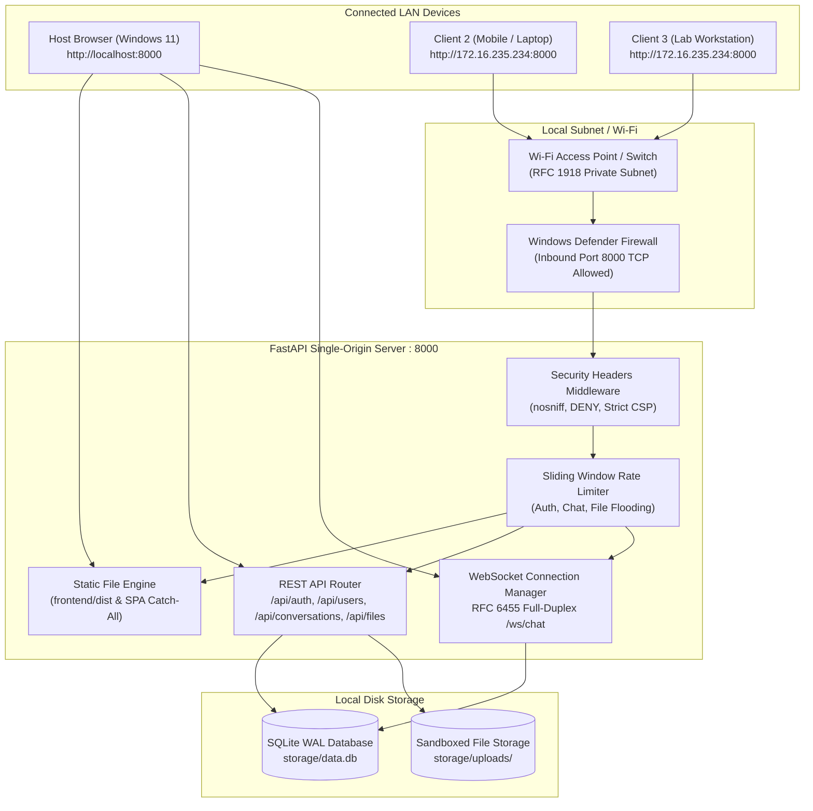
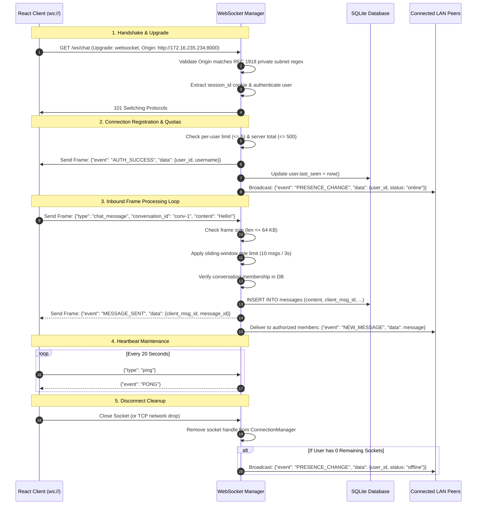

# Secure LAN Chat & File Sharing System — Technical Architecture Specification

**Version:** 1.0.0  
**Status:** Implemented & Verified  
**Author:** Arjun  
**Audience:** College Project Examiners, Systems Engineers, and Technical Evaluators  

---

## 1. Executive Summary

The **Secure LAN Chat and File Sharing System** is an asynchronous, self-hosted web application engineered for real-time messaging, presence tracking, and file transfers over Local Area Networks (LAN). Built to operate in college computer labs, campus dormitories, and offline network environments, the system requires **zero external cloud infrastructure or internet connectivity**.

The architecture combines a single-origin FastAPI (Python ASGI) host on Windows 11 with a component-driven React 18 frontend, backed by an ACID-compliant SQLite database operating in Write-Ahead Logging (`WAL`) mode and a sandboxed file storage subsystem.

---

## 2. High-Level System Architecture

The host machine runs a unified single-origin server process that binds to `0.0.0.0:8000`, simultaneously serving static frontend assets, servicing REST API endpoints, and maintaining full-duplex WebSocket connections.



---

## 3. Communication Protocols & Request Flow

### 3.1 Protocol Distribution

| Communication Channel | Protocol | Port | Purpose |
| :--- | :--- | :--- | :--- |
| **Frontend Static Assets** | HTTP/1.1 (GET) | `8000` | Serves HTML, bundled JavaScript, CSS, and favicon. |
| **Authentication & User Management** | HTTP/1.1 (REST) | `8000` | User registration, login, logout, profile updates, directory listing. |
| **Real-Time Chat & Presence** | WebSocket (RFC 6455) | `8000` | Bidirectional text messaging, delivery ACKs, typing indicators, presence. |
| **File Upload & Download** | HTTP/1.1 (Streaming) | `8000` | High-throughput chunked file streaming with SHA-256 validation. |

### 3.2 HTTP REST & Session Lifecycle

Authentication uses cryptographically secure session identifiers stored in browser cookies:

```mermaid
sequenceDiagram
    autonumber
    participant Browser as Client Browser
    participant Gateway as FastAPI Application
    participant DB as SQLite (data.db)

    Note over Browser,Gateway: 1. Registration Phase
    Browser->>Gateway: POST /api/auth/register {username, password, display_name}
    Gateway->>Gateway: Validate username regex & min length
    Gateway->>Gateway: Hash password with Argon2id (salt + memory-hard parameters)
    Gateway->>DB: INSERT INTO users ...
    Gateway-->>Browser: 201 Created {id, username, display_name}

    Note over Browser,Gateway: 2. Login & Session Establishment
    Browser->>Gateway: POST /api/auth/login {username, password}
    Gateway->>DB: SELECT * FROM users WHERE username = ?
    Gateway->>Gateway: Verify Argon2id password hash
    Gateway->>Gateway: Generate 64-char crypto-random hex token (secrets.token_hex)
    Gateway->>DB: INSERT INTO user_sessions (token, user_id, expires_at) ...
    Gateway-->>Browser: 200 OK + Set-Cookie: session_id=<token>; HttpOnly; SameSite=Lax; Path=/

    Note over Browser,Gateway: 3. Authenticated Requests
    Browser->>Gateway: GET /api/conversations (Cookie: session_id=<token>)
    Gateway->>DB: Validate session_id token & fetch user
    Gateway-->>Browser: 200 OK [Conversations List]

    Note over Browser,Gateway: 4. Clean Logout
    Browser->>Gateway: POST /api/auth/logout
    Gateway->>DB: DELETE FROM user_sessions WHERE token = <token>
    Gateway-->>Browser: 200 OK + Set-Cookie: session_id=""; Max-Age=0
```

---

## 4. WebSocket Real-Time Architecture (RFC 6455)

### 4.1 WebSocket Connection Lifecycle

Unlike raw TCP streams (which lack native message delimiters), WebSocket frames include length headers and opcodes (Text, Binary, Ping, Pong, Close).



### 4.2 WebSocket Event Contract

| Event Name | Direction | Payload Schema | Description |
| :--- | :--- | :--- | :--- |
| `AUTH_SUCCESS` | Server $\rightarrow$ Client | `{user_id, username, display_name, is_online}` | Dispatched immediately upon successful socket handshake. |
| `PRESENCE_CHANGE` | Server $\rightarrow$ Client | `{user_id, status, last_seen}` | Broadcasted to all peers when a user transitions online or offline. |
| `NEW_MESSAGE` | Server $\rightarrow$ Client | `{id, conversation_id, sender_id, content, timestamp, file}` | Delivered only to members of the conversation or broadcast channel. |
| `MESSAGE_SENT` | Server $\rightarrow$ Sender | `{client_msg_id, message_id, status: "sent"}` | Delivery confirmation and deduplication acknowledgment. |
| `TYPING_CHANGE` | Server $\rightarrow$ Client | `{conversation_id, user_id, username, is_typing}` | Ephemeral typing indicator notification. |
| `FILE_UPLOADED` | Server $\rightarrow$ Client | `{file: {...}, message: {...}}` | Real-time notification when a file attachment is successfully uploaded. |
| `ERROR` | Server $\rightarrow$ Client | `{code, message}` | Dispatched on invalid JSON, oversized frames, or rate limit violations. |
| `PONG` | Server $\rightarrow$ Client | `{timestamp}` | Response to client heartbeat `ping` frame. |

---

## 5. Database Schema & Entity Relationships

The relational data model is implemented in SQLite using SQLAlchemy ORM. All queries are parameterized, preventing SQL injection vulnerabilities.

```mermaid
erDiagram
    User ||--o{ UserSession : "has many"
    User ||--o{ ConversationMember : "participates in"
    User ||--o{ Message : "sends"
    User ||--o{ FileRecord : "uploads"
    Conversation ||--o{ ConversationMember : "contains"
    Conversation ||--o{ Message : "contains"
    Conversation ||--o{ FileRecord : "contains"
    Message ||--o| FileRecord : "attaches"

    User {
        int id PK
        string username UK
        string password_hash
        string display_name
        string avatar
        boolean is_active
        datetime created_at
        datetime last_seen
    }

    UserSession {
        int id PK
        int user_id FK
        string session_token UK
        datetime created_at
        datetime expires_at
        boolean is_active
    }

    Conversation {
        string id PK
        string type
        string name
        datetime created_at
    }

    ConversationMember {
        int id PK
        string conversation_id FK
        int user_id FK
        datetime joined_at
    }

    Message {
        int id PK
        string conversation_id FK
        int sender_id FK
        string message_type
        text content
        string client_msg_id
        datetime created_at
    }

    FileRecord {
        string id PK
        int message_id FK
        string conversation_id FK
        int uploader_id FK
        string original_name
        string storage_key UK
        int file_size
        string content_type
        string checksum_sha256
        datetime created_at
    }
```



### 5.1 SQLite Write-Ahead Logging (`WAL`) Mode

SQLite executes with the following performance and concurrency PRAGMAs:
* `PRAGMA journal_mode = WAL`: Permits concurrent readers while a write transaction is in progress.
* `PRAGMA synchronous = NORMAL`: Balances ACID guarantees with maximum write throughput.
* `PRAGMA foreign_keys = ON`: Enforces relational referential integrity across all tables.
* `PRAGMA busy_timeout = 5000`: Retries blocked lock acquisitions up to 5 seconds.

---

## 6. Sandboxed File Transfer Architecture

The file transfer subsystem enables sharing files up to 50 MB over the local network with end-to-end checksum verification.

```mermaid
sequenceDiagram
    autonumber
    participant Uploader as Alice (Browser)
    participant Server as FastAPI Server
    participant Disk as storage/uploads/
    participant DB as SQLite (data.db)
    participant Recipient as Bob (Browser)

    Note over Uploader,Server: 1. Streaming Upload Phase
    Uploader->>Server: POST /api/files/upload (multipart/form-data: file, conversation_id)
    Server->>Server: Validate conversation membership (Alice in conv-1)
    Server->>Server: Check Content-Length header <= 50 MB
    Server->>Server: Apply upload rate limiter (15 uploads / min)
    Server->>Disk: Stream binary chunks to temp file: uploads/temp_<UUID>
    Server->>Server: Compute SHA-256 hash incrementally during stream
    Server->>Disk: Atomic rename: uploads/temp_<UUID> -> uploads/<UUID>
    Server->>DB: INSERT INTO file_records (id, original_name, storage_key, checksum_sha256)
    Server->>DB: INSERT INTO messages (type="file", ...)
    Server-->>Uploader: 201 Created {id, original_name, file_size, checksum_sha256, download_url}

    Note over Server,Recipient: 2. Real-Time Broadcast Notification
    Server->>Recipient: WebSocket Frame: NEW_MESSAGE (with file attachment metadata)

    Note over Recipient,Server: 3. Streaming Download Phase
    Recipient->>Server: GET /api/files/<id>/download (Cookie: session_id)
    Server->>DB: Validate Bob's membership in conv-1 (Strict Horizontal Isolation)
    Server->>Disk: Resolve sandboxed file: uploads/<UUID>
    Server->>Server: Verify path.is_relative_to(storage/uploads) (Path Traversal Defense)
    Server-->>Recipient: 200 OK + Stream binary chunks + Content-Disposition: attachment; filename="<original_name>"
```

### 6.1 Path Traversal & Collisions Mitigations

* **UUID Storage Identifiers**: Uploaded files are never saved under the user-supplied filename. Instead, files are saved on disk as `<UUIDv4>`. User-supplied filenames are kept exclusively in the database metadata.
* **Path Containment Enforcement**: Before reading or streaming any file, the backend verifies:
  ```python
  resolved_path = (upload_dir / storage_key).resolve()
  if not resolved_path.is_relative_to(upload_dir.resolve()):
      raise HTTPException(status_code=403, detail="Access denied")
  ```
* **Atomic Rollback on Error**: If a client disconnects or an OS disk error occurs mid-stream, the partial temporary file is unlinked immediately. No corrupt records are committed to SQLite.

---

## 7. Single-Origin Frontend Serving Architecture

In development, Vite runs on port `5173`. For production and LAN deployment, FastAPI serves the compiled frontend bundle directly from `frontend/dist`.

```
                    GET / (Accept: text/html)
                    ------------------------->  Serve frontend/dist/index.html (SPA Entrypoint)
                    
                    GET /assets/* (CSS, JS)
FastAPI Server      ------------------------->  Serve frontend/dist/assets/*
  Port 8000
                    GET /api/*
                    ------------------------->  Dispatch to API Routers
                    
                    GET /ws/chat
                    ------------------------->  Upgrade to WebSocket Connection
                    
                    GET /chat, /login (SPA Routing)
                    ------------------------->  Fallback to frontend/dist/index.html
```

---

## 8. Summary of Architectural Decisions

| Decision | Alternative Considered | Justification |
| :--- | :--- | :--- |
| **Single-Origin (Port 8000)** | Dual-server (Vite 5173 + FastAPI 8000) | Eliminates CORS complications on LAN, requires only 1 firewall rule, simplifies cookies. |
| **FastAPI + Uvicorn** | Flask / Django / NodeJS | Native async/await event loop, built-in WebSocket support, high concurrent connection throughput. |
| **SQLite (WAL Mode)** | PostgreSQL / MySQL | Zero external service installation, portable single-file database, ACID compliant with WAL concurrency. |
| **UUID Storage Keys** | Sanitized original filenames | 100% immune to filesystem naming bugs, Unicode path collisions, and directory traversal. |
| **Argon2id Password Hash** | bcrypt / PBKDF2 / SHA-256 | Winner of Password Hashing Competition; memory-hard defense against GPU/ASIC cracking. |
