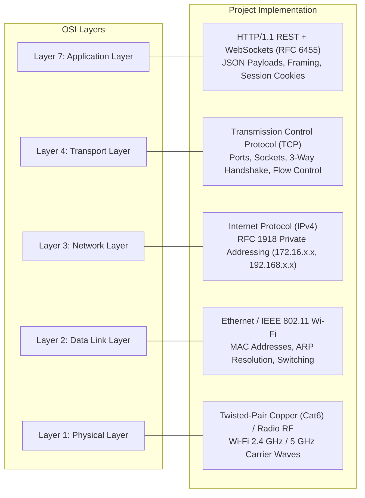
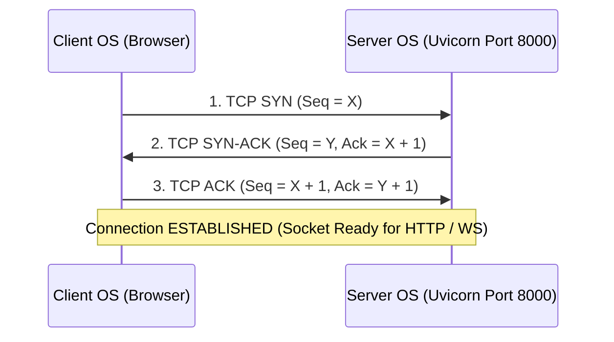

# Computer Networking Concepts & Technical Reference Guide

**Project:** Secure LAN Chat & File Sharing System  
**Author:** Arjun  
**Audience:** College Viva Examiners, Networking Instructors, and Software Engineers  

---

## 1. Introduction

This document provides a comprehensive academic analysis of the computer networking principles demonstrated by the **Secure LAN Chat and File Sharing System**. The project is an end-to-end realization of networking theory, spanning the Physical/Data Link layers through the Application Layer of the OSI and TCP/IP protocol stacks.

---

## 2. Mapping the OSI & TCP/IP Reference Models

The application directly exercises and demonstrates all five active layers of the Internet protocol suite:



---

## 3. Network Layer: IPv4 Addressing & Local Area Networks

### 3.1 Structure of an IPv4 Address
An IPv4 address is a 32-bit binary number traditionally represented in human-readable dotted-decimal notation consisting of four 8-bit octets:

$$\text{Address} = \text{Octet}_1 \cdot \text{Octet}_2 \cdot \text{Octet}_3 \cdot \text{Octet}_4 \quad (0 \le \text{Octet}_i \le 255)$$

Example from our host development machine:
$$\mathbf{172.16.235.234} = 10101100.00010000.11101011.11101010_2$$

### 3.2 Subnetting & Network/Host Division
The IP address is mathematically divided into a **Network ID** and a **Host ID** via a bitwise AND operation with a **Subnet Mask**:

$$\text{Network ID} = \text{IP Address} \;\land\; \text{Subnet Mask}$$

* For a standard `/24` network mask ($255.255.255.0$):
  * First 24 bits = Network identifier (all devices on the same wire share this prefix).
  * Last 8 bits = Unique host identifier ($2^8 - 2 = 254$ usable host addresses).

### 3.3 Private Address Spaces (RFC 1918)
To prevent global IPv4 address exhaustion, RFC 1918 designated three specific address blocks reserved strictly for private internal networks:

| Class | CIDR Block | IP Address Range | Total Addresses | Usage Context |
| :--- | :--- | :--- | :--- | :--- |
| **A** | `10.0.0.0/8` | `10.0.0.0` – `10.255.255.255` | 16,777,216 | Large enterprise networks |
| **B** | `172.16.0.0/12` | `172.16.0.0` – `172.31.255.255` | 1,048,576 | Campus networks (Current host is `172.16.235.234`) |
| **C** | `192.168.0.0/16`| `192.168.0.0` – `192.168.255.255` | 65,536 | Residential Wi-Fi routers |
| **Loopback** | `127.0.0.0/8`| `127.0.0.1` – `127.255.255.254` | 16,777,214 | Inter-process host loopback (`localhost`) |

> [!IMPORTANT]
> **Why Private Addresses Cannot Route on the Internet:**
> Internet core routers immediately drop packets containing RFC 1918 destination addresses. A home or college router uses **Network Address Translation (NAT)** to translate internal private IPs into a single public WAN IP when communicating externally. Our project stays purely within the local private subnet, meaning data packets never traverse the NAT gateway or external ISPs.

### 3.4 Automated RFC 1918 Origin Validation
In `backend/app/config.py`, the system implements a strict regular expression to dynamically validate and allow all RFC 1918 subnets while rejecting public Internet origins:

```python
CORS_ORIGIN_REGEX = (
    r"^https?:\/\/(localhost|127\.0\.0\.1|10\.\d{1,3}\.\d{1,3}\.\d{1,3}|"
    r"192\.168\.\d{1,3}\.\d{1,3}|172\.(1[6-9]|2\d|3[0-1])\.\d{1,3}\.\d{1,3})(:\d+)?$"
)
```

---

## 4. Transport Layer: TCP vs. UDP & Socket Architecture

### 4.1 Why TCP is Essential for Messaging & File Sharing

| Requirement | Transmission Control Protocol (TCP) | User Datagram Protocol (UDP) | Project Decision |
| :--- | :--- | :--- | :--- |
| **Connection State** | Connection-Oriented (3-way handshake) | Connectionless (fire-and-forget) | **TCP Selected** |
| **Reliability** | Guaranteed delivery via ACKs & Retransmit | Unreliable (dropped packets lost forever) | **TCP Selected** |
| **Ordering** | In-order byte stream (Sequence Numbers) | Packets may arrive out of order | **TCP Selected** |
| **Flow Control** | Dynamic sliding window (prevents receiver overflow) | None | **TCP Selected** |
| **Integrity** | End-to-end 16-bit checksum | Optional 16-bit checksum | **TCP Selected** |

*Text messages and executable file downloads cannot tolerate dropped or corrupted packets. A single missing byte in an image or zip archive corrupts the entire file. TCP guarantees byte-exact delivery.*

### 4.2 The TCP 3-Way Handshake
Before any HTTP request or WebSocket message is exchanged, the client operating system and the Uvicorn server establish a TCP connection:



### 4.3 Sockets and Port Multiplexing
A **Network Socket** is an abstract software endpoint defined by a 4-tuple:
$$\text{Socket Connection} = \langle \text{Source IP}, \text{Source Port}, \text{Dest IP}, \text{Dest Port} \rangle$$

* **Server Port (Well-Known / Registered)**: The FastAPI server listens on port `8000`.
* **Client Ephemeral Ports**: When Chrome or Safari connects, the client OS dynamically assigns a temporary high-range port (e.g., `54321`) from the ephemeral range (`49152`–`65535`).
* **Socket Multiplexing**: The operating system kernel routes incoming packets on port `8000` to the correct client session based on the unique combination of the client's IP and ephemeral port.

### 4.4 Host Binding Semantics (`0.0.0.0` vs `127.0.0.1`)
* `127.0.0.1` (`INADDR_LOOPBACK`): The kernel only accepts packets originating from inside the host machine itself. Second devices on the Wi-Fi cannot connect.
* `0.0.0.0` (`INADDR_ANY`): Binds the server to all network adapters simultaneously. The server listens on:
  * Loopback interface (`127.0.0.1`)
  * Wireless LAN adapter (`172.16.235.234`)
  * Physical Ethernet adapters
  * Virtual adapters (WSL, Hyper-V, VPNs)

---

## 5. Application Layer: HTTP vs. WebSockets (RFC 6455)

### 5.1 The Fundamental Flaw of Raw TCP for Browsers
A common question in student projects is: *Why can't the React frontend just open a raw Python `socket.socket()` directly to the server?*

1. **Browser Security Sandbox**: Web browsers strictly forbid raw TCP access to prevent client scripts from performing port scanning or launching cross-protocol attacks against internal infrastructure.
2. **Stream Coalescing (The Nagle / Framing Bug)**: Raw TCP is a continuous byte stream without message boundaries. If a client transmits a 50-byte header followed immediately by 10 KB of file data, Nagle's algorithm may coalesce them into a single TCP segment. The receiving server's `socket.recv(1024)` will read both together, crashing text decoders or corrupting binary files.

### 5.2 How WebSockets (RFC 6455) Solve Framing
WebSockets upgrade an existing HTTP connection into a full-duplex persistent stream with **built-in message framing**:

```
 0                   1                   2                   3
 0 1 2 3 4 5 6 7 8 9 0 1 2 3 4 5 6 7 8 9 0 1 2 3 4 5 6 7 8 9 0 1
+-+-+-+-+-------+-+-------------+-------------------------------+
|F|R|R|R| opcode|M| Payload len |    Extended payload length    |
|I|S|S|S|  (4)  |A|     (7)     |             (16/64)           |
|N|V|V|V|       |S|             |   (if payload len==126/127)   |
| |1|2|3|       |K|             |                               |
+-+-+-+-+-------+-+-------------+ - - - - - - - - - - - - - - - +
|     Masking-key (32 bits, client-to-server only)              |
+---------------------------------------------------------------+
|                     Payload Data (N Bytes)                    |
+---------------------------------------------------------------+
```

* **FIN bit**: Identifies whether this frame is the final fragment of a message.
* **Opcode**: Specifies frame type (`0x1` = Text/JSON, `0x2` = Binary, `0x8` = Close, `0x9` = Ping, `0xA` = Pong).
* **Payload Length**: Encodes the exact byte length. The receiving socket buffers until the complete frame arrives before passing it to Python. Boundaries are never lost.
* **Masking Key**: All client-to-server frames are XOR masked with a 32-bit random key to prevent malicious scripts from poisoning intermediate network proxy caches.

---

## 6. Data Link Layer: MAC Addresses, ARP, & Switching

### 6.1 Address Resolution Protocol (ARP)
While IP addresses govern end-to-end logical routing, local network devices communicate across switches using 48-bit physical **Media Access Control (MAC) addresses**:

1. Host wants to send a frame to `172.16.235.1` (Default Gateway).
2. Host checks its local ARP cache (`arp -a`).
3. If not cached, the host broadcasts an **ARP Request** (`FF:FF:FF:FF:FF:FF`): *"Who has 172.16.235.1? Tell 172.16.235.234"*.
4. The router responds with an **ARP Reply** unicast: *"172.16.235.1 is at 00:1A:2B:3C:4D:5E"*.
5. The Ethernet frame is encapsulated with the destination MAC address and transmitted.

### 6.2 Switched Ethernet vs. Wi-Fi Broadcast Media
* **Switched Ethernet**: Network switches inspect the destination MAC address of incoming frames and forward them only to the specific physical switch port where the destination device resides (via CAM table lookup).
* **Wi-Fi Media**: Radio waves travel through the air in all directions. Even though frames contain destination MAC addresses, any wireless network card in **promiscuous mode** can physically receive and record all transmitted radio frames on the channel.

---

## 7. Firewall & Network Security Architecture

### 7.1 Stateful Packet Inspection (SPI)
Windows Defender Firewall operates as a stateful packet filter:
* **Outbound Traffic**: Allowed by default. When the host browser accesses a web page, the firewall tracks the connection state in a state table and automatically permits incoming response packets.
* **Inbound Traffic**: Blocked by default. Unsolicited incoming SYN packets from external phones or laptops on port `8000` are dropped unless an explicit inbound rule exists.

### 7.2 Windows Network Profiles (Private vs. Public)
Windows assigns connected networks to one of three security profiles:
1. **Public Profile**: Intended for coffee shops and airports. Windows blocks all local file sharing, discovery broadcasts, and inbound ports.
2. **Private Profile**: Intended for trusted home or laboratory networks. Enables local resource sharing.
3. **Domain Profile**: Managed by enterprise Active Directory controllers.

Our project's firewall rule explicitly targets the **Private** profile:
```powershell
New-NetFirewallRule -DisplayName "Secure LAN Chat" `
                    -Direction Inbound `
                    -LocalPort 8000 `
                    -Protocol TCP `
                    -Action Allow `
                    -Profile Private
```

### 7.3 Wi-Fi Client Isolation (AP Isolation)
On many public university or guest Wi-Fi networks, access points enable **AP Isolation**. The wireless router deliberately drops any direct packets between connected wireless stations.
* **Symptom**: Phone and PC are on the same Wi-Fi, but `ping 172.16.235.234` times out.
* **Mitigation**: Connect to a standard home Wi-Fi SSID, or enable a **Windows 11 Mobile Hotspot**, creating a direct virtual Wi-Fi interface where AP isolation is disabled.

---

## 8. Viva Questions & Project Demonstration Mapping

| Theoretical Concept | Examiner Question | Where It Is Demonstrated in Project |
| :--- | :--- | :--- |
| **Layer 3: IP Addressing** | How does the server adapt when DHCP changes the host IP? | `run_server.py` queries default kernel routing via UDP socket lookup and dynamically prints the current LAN IP. The React frontend uses `window.location.host` instead of hardcoding IPs. |
| **Layer 4: Socket Concurrency** | How does the server handle multiple simultaneous clients without freezing? | FastAPI runs on the asynchronous `asyncio` event loop inside Uvicorn. Coroutines handle thousands of concurrent WebSocket connections on a single thread. |
| **Layer 7: Framing** | Why use WebSockets instead of a simple TCP socket in the browser? | WebSockets provide RFC 6455 frame-length headers, preventing TCP message coalescing bugs, and operate inside the browser's security sandbox. |
| **Security & CSWSH** | How do you prevent unauthorized websites from hijacking the LAN chat socket? | `backend/app/websocket/router.py` validates the `Origin` header during the HTTP Upgrade handshake against `CORS_ORIGIN_REGEX`. |
| **File Transfer** | Why stream files in chunks instead of buffering the whole file in RAM? | `backend/app/routers/files.py` streams 64 KB binary chunks directly to disk with SHA-256 calculation. Memory usage remains constant even for 50 MB files. |
