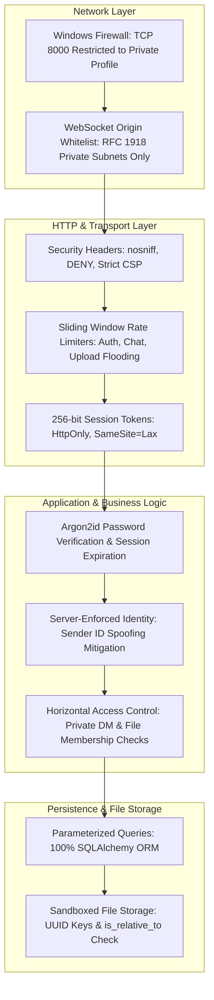

# Security Architecture & Threat Model Specification

**Project:** Secure LAN Chat & File Sharing System  
**Version:** 1.0.0  
**Status:** Implemented & Verified (11 Automated Security Tests Passing)  
**Author:** Arjun  
**Audience:** Security Engineers, College Examiners, and Technical Evaluators  

---

## 1. Security Philosophy & Defense-in-Depth

The **Secure LAN Chat and File Sharing System** operates on the principle of **Defense-in-Depth**. Security is not relegated to a single perimeter check; instead, every layer of the architecture (network gateway, session cookies, database access, WebSocket frames, and filesystem storage) independently verifies authorization, validates inputs, and restricts resource consumption.



---

## 2. Authentication & Credential Management

### 2.1 Password Hashing with Argon2id
Plaintext passwords are never logged, stored in memory longer than necessary, or written to disk. The application utilizes **Argon2id** (the gold-standard winner of the Password Hashing Competition) via `argon2-cffi`.

* **Algorithm Choice**: Argon2id combines Argon2d (data-dependent memory access for maximum resistance against GPU cracking) and Argon2i (data-independent memory access for maximum resistance against side-channel cache attacks).
* **Salt Generation**: A cryptographically random 16-byte salt is generated per user.
* **Cost Parameters**:
  * Memory Cost: 65,536 KiB (64 MiB RAM per hash).
  * Time Cost: 3 iterations.
  * Parallelism: 4 threads.

### 2.2 Session Management Architecture
* **Token Generation**: Upon successful authentication, the server generates a 256-bit random token using Python's `secrets.token_hex(32)`.
* **Cookie Attributes**:
  * `HttpOnly`: Accessible only to the browser network stack. JavaScript code (including malicious XSS payloads) cannot read `document.cookie`.
  * `SameSite=Lax`: Protects against Cross-Site Request Forgery (CSRF). Cookies are only sent on first-party top-level navigations.
  * `Path=/`: Restricts scope to application root.
* **Session Destruction on Logout**: Logout performs an immediate database record deletion (`DELETE FROM user_sessions WHERE session_token = ?`) and overwrites the client cookie with `Max-Age=0`. The session token cannot be reused even if captured.
* **Session Quota Enforcement**: Users are limited to a maximum of 5 concurrent sessions (`MAX_SESSIONS_PER_USER`). Logging in on a 6th device automatically revokes the oldest session.

---

## 3. Server-Enforced Authorization & Horizontal Privilege Separation

### 3.1 Mitigation of Identity Spoofing
Clients cannot specify their own `sender_id` or `author` in WebSocket frames or REST payloads. The server extracts the authenticated `user_id` strictly from the session cookie in the HTTP request or WebSocket handshake scope:

$$\text{Authenticated User} = \text{Lookup}(\text{Cookie}[\text{"session\_id"}])$$

Any client attempting to insert another user's ID into a message payload is overridden by the server's session identity.

### 3.2 Horizontal Isolation on Private Chats
A critical flaw in basic chat prototypes is horizontal privilege escalation (User C reading private messages between User A and User B).

In `ChatService.verify_conversation_access`:
```python
def verify_conversation_access(conversation_id: str, user_id: int, db: Session):
    # Broadcast channel is public to all authenticated subnet users
    if conversation_id == "broadcast-general":
        return True
    
    # Validate conversation ID format against regex
    validate_conversation_id_format(conversation_id)

    # For private conversations, verify user is an explicit member
    member = db.query(ConversationMember).filter(
        ConversationMember.conversation_id == conversation_id,
        ConversationMember.user_id == user_id
    ).first()
    
    if not member:
        raise AppException(code="FORBIDDEN", message="You do not have access to this conversation.", status_code=403)
```

### 3.3 Horizontal Isolation on File Downloads
Files shared in private conversations inherit the access control of that conversation:
1. Alice uploads `financials.pdf` to her private DM with Bob.
2. The database records `conversation_id` on the `FileRecord`.
3. When Charlie attempts `GET /api/files/<file_id>/download`, the server queries the database, detects that Charlie is not a member of the conversation, and returns `403 Forbidden`.

---

## 4. Input Sanitization & Injection Prevention

### 4.1 SQL Injection Prevention
* 100% of database interactions are executed through SQLAlchemy ORM with parameterized statements.
* No string concatenation (`f"SELECT * FROM users WHERE username = '{username}'"`) is permitted anywhere in the backend codebase.

### 4.2 Cross-Site Scripting (XSS) Prevention
* **Frontend JSX Escaping**: React escapes all interpolated text nodes by default before inserting them into the DOM.
* **Zero `dangerouslySetInnerHTML`**: A complete audit confirmed zero instances of `dangerouslySetInnerHTML` in the React frontend.
* **Content Security Policy (CSP)**: The server injects a strict CSP prohibiting unauthorized external scripts:
  ```http
  Content-Security-Policy: default-src 'self'; script-src 'self'; style-src 'self' 'unsafe-inline'; img-src 'self' data: blob:; connect-src 'self' ws: wss:; font-src 'self'; object-src 'none'; frame-ancestors 'none';
  ```

### 4.3 Path Traversal Prevention (CWE-22)
* **UUID Storage Identifiers**: Uploaded files are never stored on disk under their original user-provided filename. The file is saved as `<UUIDv4>` in `storage/uploads/`.
* **Path Containment Check**:
  ```python
  target_file = (upload_dir / storage_key).resolve()
  if not target_file.is_relative_to(upload_dir.resolve()):
      raise AppException(code="ACCESS_DENIED", message="Path traversal detected.", status_code=403)
  ```

---

## 5. Network & WebSocket Protections

### 5.1 Cross-Site WebSocket Hijacking (CSWSH) Defense
Unlike standard cross-origin HTTP requests, browsers do **not** enforce Same-Origin Policy on WebSocket connections. If a user visits a malicious website (`http://evil-attacker.com`) while logged into LAN chat, the malicious page could attempt to open a WebSocket connection to `ws://172.16.235.234:8000/ws/chat`.

* **Mitigation**: During the HTTP Upgrade handshake, `ConnectionManager.is_origin_allowed` verifies the `Origin` header against `CORS_ORIGIN_REGEX`.
* Unrecognized or public Internet origins are closed immediately with code `1008 Policy Violation`.

### 5.2 Denial of Service (DoS) & Resource Limits
* **Maximum WebSocket Frame Size**: Capped at **64 KB** (`MAX_WS_FRAME_SIZE_BYTES = 65536`). Oversized text frames are rejected with `MESSAGE_TOO_LARGE`.
* **Maximum Concurrent Connections**:
  * Max 5 concurrent sockets per user.
  * Max 500 total system sockets.
* **Maximum File Upload Size**: Capped at **50 MB** (`MAX_UPLOAD_SIZE_BYTES = 52428800`). Pre-checked using `Content-Length` headers before streaming to disk.
* **Sliding-Window Rate Limiting**:
  * Auth endpoints: 10 requests / 60 seconds per IP/username.
  * Chat messages: 10 messages / 3 seconds per user.
  * File uploads: 15 uploads / 60 seconds per user.

---

## 6. The Encryption Spectrum: Academic Analysis

Examiners frequently ask about encryption. A common misconception is conflating transport encryption, encryption at rest, and end-to-end encryption.

```
+-----------------------------------------------------------------------------+
|                     THREE DISTINCT CRYPTOGRAPHIC DOMAINS                    |
|                                                                             |
| 1. Transport Encryption (TLS 1.3 / HTTPS / WSS)                             |
|    * Protects: In-transit packets across the LAN / Wi-Fi wire.              |
|    * Terminus: Decrypted in server RAM (FastAPI sees plaintext).            |
|                                                                             |
| 2. Encryption at Rest (SQLCipher / OS DPAPI / TPM 2.0)                      |
|    * Protects: Filesystem data on disk if server laptop is physically stolen|
|    * Terminus: Read into memory upon server startup.                        |
|                                                                             |
| 3. End-to-End Encryption (E2EE - Signal Protocol / Web Crypto API)          |
|    * Protects: Message payloads from the server itself.                     |
|    * Terminus: Only Alice and Bob hold private keys; server sees ciphertext.|
+-----------------------------------------------------------------------------+
```

### 6.1 The "LAN Implies Confidentiality" Fallacy
Local Area Networks do not provide confidentiality:
1. **Wi-Fi Packet Sniffing**: On shared WPA2-Personal networks, any client with the Wi-Fi password can capture 4-way handshakes and decrypt unicast traffic from other devices in promiscuous mode.
2. **ARP Cache Poisoning**: Switched Ethernet can be redirected using ARP spoofing tools (`arpspoof`, `ettercap`), routing all subnet traffic through an attacker's machine.

### 6.2 Transport Encryption Deployment Options
In production environments, TLS terminates at Uvicorn:
* **Option A: Local CA (`mkcert`)**: Generates a custom root certificate installed on client devices. Provides green HTTPS lock with no warnings.
* **Option B: Self-Signed Certificate**: Quick `openssl` command. Provides full TLS encryption, but browsers display a security warning on first visit.
* **Option C: Split-Horizon DNS + Let's Encrypt**: Enterprise deployment resolving internal hostname (e.g., `chat.lab.university.edu`) via public DNS-01 challenge.

### 6.3 The "Key Next to Data" Anti-Pattern for Encryption at Rest
Storing an encryption key in `secret.key` beside `data.db` on disk provides zero actual security. Any attacker with read access to the server directory will read the key and decrypt the database. Genuine encryption at rest requires hardware security modules (TPM 2.0), OS-level keyrings (DPAPI on Windows), or an administrator startup passphrase (KDF).

---

## 7. Security Verification Matrix

All 11 automated security tests pass with 100% success rate (`backend/tests/test_security.py`):

| Test Function | Security Control Verified | Result |
| :--- | :--- | :--- |
| `test_security_headers_present` | Verifies `nosniff`, `DENY`, `mode=block`, and strict CSP headers | **PASSED** |
| `test_authentication_bypass_blocked` | Unauthenticated requests return `401 Unauthorized` | **PASSED** |
| `test_login_brute_force_rate_limiting` | 11 rapid login attempts trigger `429 Too Many Requests` | **PASSED** |
| `test_file_upload_rate_limiting` | Rapid upload flooding triggers `429 Too Many Requests` | **PASSED** |
| `test_websocket_unauthorized_origin_rejection` | External origins rejected with code `1008 Policy Violation` | **PASSED** |
| `test_websocket_unauthenticated_rejection` | Missing session cookies rejected during handshake | **PASSED** |
| `test_websocket_oversized_payload_rejected` | Frames > 64 KB rejected with `MESSAGE_TOO_LARGE` | **PASSED** |
| `test_cross_user_private_chat_isolation` | User C blocked from Alice and Bob's private conversation | **PASSED** |
| `test_cross_user_private_file_download_isolation` | User C blocked from downloading private files | **PASSED** |
| `test_invalid_conversation_id_format_rejection` | Path traversal identifiers (`../`, `../../etc`) rejected | **PASSED** |
| `test_logout_invalidates_session_token` | Revoked session token returns `401 Unauthorized` | **PASSED** |

---

## 8. Known Limitations & Non-Claims

1. **No In-Line Antivirus / Malware Scanning**: The application verifies file sizes, paths, and SHA-256 hashes, but does not scan binary contents with an antivirus engine (e.g. ClamAV). Administrators should rely on endpoint protection.
2. **Plaintext Server Persistence Baseline**: In the current implementation, messages and file records are stored in plaintext within SQLite on the host filesystem. Zero-knowledge E2EE is documented as an architectural path for future scope.
3. **In-Memory Rate Limiting Lifespan**: Sliding-window rate limit counters reside in server memory and reset upon server restart.
