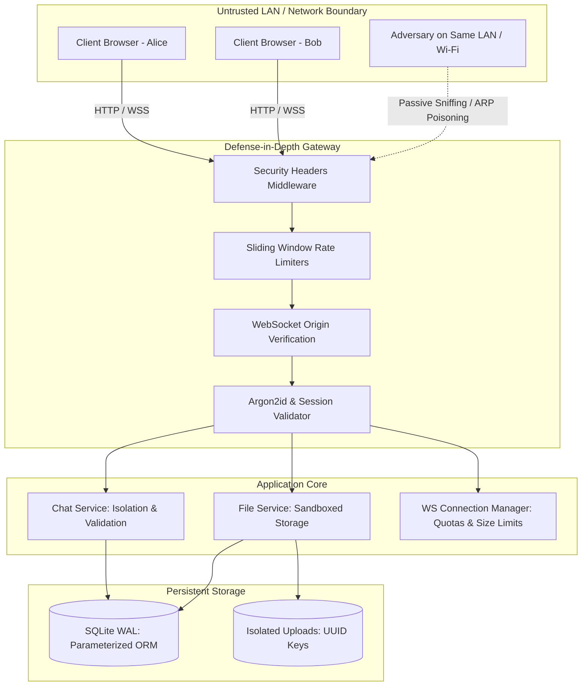
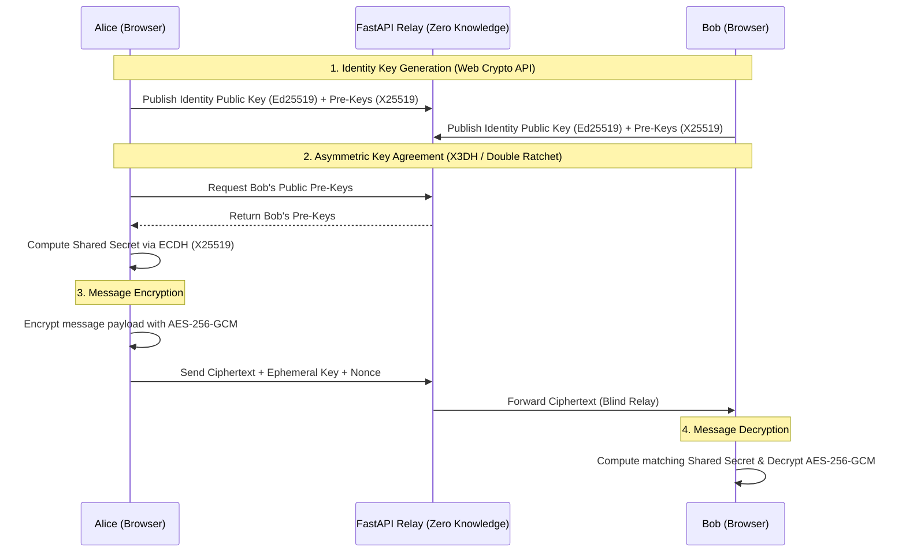

# Secure LAN Chat & File Sharing System — Security Report & Threat Model

**Version:** 1.0.0  
**Phase:** Phase 6 Security Hardening  
**Date:** October 2026  
**Audience:** System Administrators, Security Engineers, and Academic Reviewers  

---

## 1. Executive Summary

Secure LAN Chat is a self-hosted messaging and file sharing platform architected for local area network (LAN) collaboration. Phase 6 establishes rigorous, multi-layered defense-in-depth protections across authentication, authorization, session management, network sockets, input validation, and file persistence.

This document presents a structured threat model, details all implemented security controls, presents a practical encryption strategy addressing local network vulnerabilities, and outlines residual operational risks.

---

## 2. Threat Model & Risk Analysis

### 2.1 Assets & Security Objectives

| Asset | Security Objective | Criticality |
| :--- | :--- | :--- |
| **User Credentials** | Protect passwords from disclosure or brute-force cracking | Critical |
| **Session Tokens** | Prevent session hijacking, forgery, or fixation | Critical |
| **Private Chat Logs** | Guarantee confidentiality and integrity between authorized participants | High |
| **LAN Broadcast Messages** | Maintain message integrity, verifiable authorship, and auditability | Medium |
| **Shared File Payloads** | Ensure confidentiality, prevent unauthorized downloads and data corruption | High |
| **Storage & Host File System** | Protect server OS and file system against arbitrary file writes/reads | Critical |
| **Server Availability** | Safeguard server resources (CPU, RAM, sockets, disk) from DoS | High |

### 2.2 Trust Boundaries

1. **Client Browser $\leftrightarrow$ Application Gateway (LAN / Loopback):**
   - All network traffic crossing the LAN boundary is considered exposed unless wrapped in transport encryption (TLS). Untrusted peers, rogue routers, and passive sniffers share the physical or wireless medium.
2. **Application Process $\leftrightarrow$ Host File System:**
   - User inputs (such as filenames and conversation IDs) must never dictate file system traversal or execute system calls.
3. **Application Process $\leftrightarrow$ SQLite Database:**
   - User inputs must never alter query structures. All database interactions must use parameterized statements.
4. **User A $\leftrightarrow$ User B (Horizontal Isolation):**
   - An authenticated user has no inherent authority to view or interact with conversations or files belonging to other users unless explicitly admitted as a member.



### 2.3 Attacker Profiles & Attack Vectors

1. **Passive LAN Eavesdropper:**
   - *Profile:* A station on the same Wi-Fi SSID or hub promiscuously capturing unencrypted packets.
   - *Threat:* Intercepting session cookies, chat messages, or files if plain HTTP/WS is used without TLS.
2. **Active LAN Attacker (Man-in-the-Middle):**
   - *Profile:* A host on the LAN executing ARP cache poisoning or DNS spoofing.
   - *Threat:* Injecting malicious scripts, hijacking TCP sessions, or performing Cross-Site WebSocket Hijacking (CSWSH).
3. **Malicious Authenticated LAN User:**
   - *Profile:* A registered peer attempting to abuse application endpoints.
   - *Threat:* Brute-forcing passwords, spamming WebSocket frames, flooding file storage, accessing other users' private DMs or confidential files via forged identifiers.
4. **Web-Based Attacker (Cross-Origin):**
   - *Profile:* An external malicious website visited by a LAN user.
   - *Threat:* Initiating cross-site requests (CSRF), clickjacking the chat window inside an iframe, or opening unauthorized WebSocket connections.

---

## 3. Implemented Security Controls

### 3.1 Defense-in-Depth Matrix

| Threat | Vulnerability / Attack Vector | Implemented Mitigation | Verification Test |
| :--- | :--- | :--- | :--- |
| **Credential Guessing** | Password brute force & dictionary attacks | Argon2id hashing + IP/Username sliding window rate limiter (10 attempts/min) returning `429 Too Many Requests` | `test_login_brute_force_rate_limiting` |
| **Session Hijacking** | Cookie theft & fixation | Cryptographically secure 256-bit random hex tokens, `HttpOnly`, `SameSite=Lax`, strict server-side revocation on logout | `test_logout_invalidates_session_token` |
| **Cross-Site WebSocket Hijacking (CSWSH)** | Malicious websites connecting to LAN WebSocket | Strict whitelist verification of the `Origin` header during WebSocket handshake; closes socket with code `1008 Policy Violation` | `test_websocket_unauthorized_origin_rejection` |
| **Unauthorized Socket Access** | Unauthenticated peers establishing real-time feeds | Cookie extraction and session token lookup during handshake; unauthenticated handshakes rejected with code `1008` | `test_websocket_unauthenticated_rejection` |
| **Socket Buffer Exhaustion (DoS)** | Giant WebSocket frames consuming server RAM | Strict frame size ceiling of 64 KB (`MAX_WS_FRAME_SIZE_BYTES`); oversized frames rejected with `MESSAGE_TOO_LARGE` | `test_websocket_oversized_payload_rejected` |
| **Connection Flooding** | Exhausting server socket handles | Quota enforcement: max 5 concurrent sockets per user, max 500 total system sockets | `test_websocket_presence_and_cleanup` |
| **Horizontal Privilege Escalation (DMs)** | User C querying private messages between Alice & Bob | Mandatory conversation membership check in `ChatService.verify_conversation_access`; unauthorized queries rejected with `403 Forbidden` | `test_cross_user_private_chat_isolation` |
| **Horizontal Privilege Escalation (Files)** | User C downloading private attachments | `FileService.verify_file_access` validates requester membership before streaming file content; returns `403 Forbidden` | `test_cross_user_private_file_download_isolation` |
| **Path Traversal / Arbitrary Overwrite** | Malicious filenames (e.g. `../../etc/passwd`) | UUIDv4-based storage keys; sanitized filenames via `Path(name).name`; validation via `path.resolve().is_relative_to(sandbox)` | `test_unsafe_filename_sanitization` |
| **Storage Exhaustion (DoS)** | Rapid large file upload flooding | 50 MB upload ceiling, Content-Length pre-check, sliding-window upload rate limiting (10 uploads/min) returning `429` | `test_file_upload_rate_limiting` |
| **SQL Injection** | SQL query manipulation via user inputs | 100% SQLAlchemy ORM parameterized queries; regex validation on conversation IDs (`^[a-zA-Z0-9_\-]{3,64}$`) | `test_invalid_conversation_id_format_rejection` |
| **Cross-Site Scripting (XSS)** | Injected JavaScript payloads in chat bubbles | React automatic text escaping in JSX (zero `dangerouslySetInnerHTML`), strict CSP header preventing inline scripts | `test_security_headers_present` |
| **Clickjacking & MIME Confusion** | Embedding app in malicious iframe / MIME sniffing | `X-Frame-Options: DENY`, `frame-ancestors 'none'`, and `X-Content-Type-Options: nosniff` headers on all HTTP responses | `test_security_headers_present` |

### 3.2 Security Headers Specification

Every HTTP response emitted by the application contains the following headers enforced via `SecurityHeadersMiddleware`:

```http
X-Content-Type-Options: nosniff
X-Frame-Options: DENY
X-XSS-Protection: 1; mode=block
Referrer-Policy: strict-origin-when-cross-origin
Permissions-Policy: camera=(), microphone=(), geolocation=(), payment=()
Content-Security-Policy: default-src 'self'; script-src 'self'; style-src 'self' 'unsafe-inline'; img-src 'self' data: blob:; font-src 'self'; connect-src 'self' ws: wss:; frame-ancestors 'none'; object-src 'none'; base-uri 'self';
```

---

## 4. Encryption Architecture & LAN Threat Realities

### 4.1 Debunking the "LAN Implies Confidentiality" Myth

A common architectural fallacy is assuming that because an application runs on an internal local area network, network traffic is inherently secure. In modern network environments, this assumption is demonstrably false:

1. **Shared Wireless Media:**
   - On standard WPA2/WPA3-Personal Wi-Fi networks, all stations share a pre-shared key (PSK). A peer possessing the network password can capture the 4-way handshake of another station and decrypt all unicast traffic sent by that device using tools like Wireshark.
2. **Switched Ethernet ARP Poisoning:**
   - Switched Ethernet isolates unicast traffic under normal operations. However, any station on the local subnet can emit unsolicited ARP replies (ARP spoofing / cache poisoning), mapping the default gateway's IP to the attacker's MAC address. This seamlessly routes all subnet traffic through the attacker's machine without physical tap access.
3. **Rogue DHCP & DNS Hijacking:**
   - A rogue node on the LAN can reply to DHCP discovery broadcasts faster than the genuine router, assigning itself as the DNS server and gateway, completely intercepting unencrypted HTTP and WebSocket streams.

**Conclusion:** Local-network isolation provides zero cryptographic confidentiality or integrity. Defense-in-depth requires explicit transport encryption.

---

### 4.2 Transport Layer Security (TLS 1.3 / HTTPS / WSS)

Transport encryption ensures that all traffic between the browser and the FastAPI backend cannot be read or tampered with by any other device on the LAN.

#### Implementation Options for LAN Environments

| Approach | Trust Mechanism | Operational Complexity | Browser Experience | Recommendation |
| :--- | :--- | :--- | :--- | :--- |
| **Local CA via `mkcert`** | Generates a custom Root Certificate Authority installed into client trust stores | Moderate (one-time CA install per client device) | Seamless green lock; no warnings | **Recommended for small teams / lab LANs** |
| **Self-Signed Certificates** | Server generates self-signed RSA/ECDSA certificate | Low (trivial `openssl req` command) | Warning dialogs on first visit (`NET::ERR_CERT_AUTHORITY_INVALID`) | Development & fallback only |
| **Split-Horizon Internal DNS + Let's Encrypt** | Public domain name resolving to private LAN IP (e.g., `chat.internal.example.com` $\rightarrow$ `192.168.1.100`) via DNS-01 challenge | High (requires public domain ownership and DNS API access) | Flawless public trust; automatic renewal | **Recommended for enterprise LAN deployments** |

#### Production Uvicorn TLS Activation

To run the backend with native TLS in production:
```bash
uvicorn app.main:app \
  --host 0.0.0.0 \
  --port 8443 \
  --ssl-keyfile /path/to/key.pem \
  --ssl-certfile /path/to/cert.pem
```
When TLS is active:
- Web browsers connect via `https://<LAN_IP>:8443`.
- WebSocket handshakes upgrade via `wss://<LAN_IP>:8443/ws/chat`.
- Cookies automatically adopt `Secure` attributes (`SESSION_COOKIE_SECURE=True`).

---

### 4.3 Encryption at Rest

#### The "Key Stored Next to Data" Anti-Pattern
Encrypting `data.db` or the `storage/uploads/` directory while storing the decryption key in an unencrypted file (e.g. `secret.key`) in the same directory provides **zero security**. Any attacker or unauthorized process gaining file-read permissions on the server will read the key and decrypt the database immediately.

#### True Encryption at Rest Architecture

For environments requiring data-at-rest protection (e.g., safeguarding against physical disk theft or decommissioned drive exposure):

1. **Hardware-Backed Key Protection (TPM 2.0 / OS Keyring):**
   - On Windows: Keys protected via Windows DPAPI (`CryptProtectData`) tied to the service account.
   - On Linux: Keys protected via kernel keyring or TPM 2.0 NVRAM indexes.
2. **Administrator Passphrase KDF:**
   - The master database key is derived from an administrative passphrase entered at application startup using Argon2id. The key resides purely in the application process's volatile memory and is never written to disk.
3. **Database-Level Cryptography (SQLCipher):**
   - SQLite files encrypted using authenticated 256-bit AES-CBC with HMAC-SHA512 per page.

---

### 4.4 End-to-End Encryption (E2EE)

#### Distinguishing Transport Security from E2EE

- **Transport Encryption (HTTPS/WSS):** Encrypts data in transit between the client and the server. The server terminates TLS and processes messages, conversation metadata, and files in plaintext. A compromised server administrator or backend breach exposes conversation contents.
- **End-to-End Encryption (E2EE):** Encrypts data directly on the sender's client device using cryptographic keys known only to the conversation participants. The server acts as a blind transport relay, storing and forwarding only ciphertext. Neither the server nor any intermediary can inspect message contents or file payloads.

#### Architecture for Browser-Based E2EE

To implement true E2EE in a web browser without trusting server-side memory:



- **Client Key Generation:** Utilizes the browser's native `window.crypto.subtle` API. Private keys are marked non-extractable and persisted in the browser's secure `IndexedDB`.
- **Ratchet Protocol:** Employs the Double Ratchet Algorithm to provide forward secrecy (past messages cannot be decrypted if current keys are compromised) and break-in recovery.

---

## 5. Residual Risks & Documented Limitations

The current system implements robust hardening against common LAN attacks, privilege escalation, and injection vectors. The following limitations are documented for administrative awareness:

1. **Self-Signed Certificate Trust Warnings:**
   - Without an enterprise PKI or local CA (`mkcert`) installed on client machines, self-signed HTTPS certificates will produce browser warning dialogs. Users must be instructed on how to verify certificate thumbprints rather than routinely clicking through warnings.
2. **Absence of In-Line Antivirus / Malware Scanning:**
   - The file upload subsystem enforces strict sandboxing, path validation, extension checks, and file size quotas. However, it does not scan file contents with an antivirus engine (e.g. ClamAV). Uploaded binaries or office documents could contain malicious macros or exploits targeting recipient workstations. LAN administrators should ensure endpoint protection is active on client machines.
3. **In-Memory Rate Limiting Counters:**
   - Rate limiters use thread-safe, in-memory sliding windows. A server restart clears active rate tracking windows. While fully sufficient for a single-node LAN application, a distributed multi-node deployment would require an external state store (such as Redis).
4. **Current Baseline Storage Model:**
   - In the Phase 6 baseline, messages and file metadata are stored server-side in SQLite in plaintext, protected by operating system file ACLs and database connection authorization. Full End-to-End Encryption (E2EE) requires client-side Web Crypto key management as specified in Section 4.4.

---

## 6. Security Verification Results

The automated security test suite (`backend/tests/test_security.py`) validates the hardened implementation with 100% pass rates across 11 dedicated security test suites and 45 comprehensive project tests:

```text
============================= test session starts =============================
tests/test_security.py::test_security_headers_present PASSED             [  9%]
tests/test_security.py::test_authentication_bypass_blocked PASSED        [ 18%]
tests/test_security.py::test_login_brute_force_rate_limiting PASSED      [ 27%]
tests/test_security.py::test_file_upload_rate_limiting PASSED            [ 36%]
tests/test_security.py::test_websocket_unauthorized_origin_rejection PASSED [ 45%]
tests/test_security.py::test_websocket_unauthenticated_rejection PASSED  [ 54%]
tests/test_security.py::test_websocket_oversized_payload_rejected PASSED [ 63%]
tests/test_security.py::test_cross_user_private_chat_isolation PASSED    [ 72%]
tests/test_security.py::test_cross_user_private_file_download_isolation PASSED [ 81%]
tests/test_security.py::test_invalid_conversation_id_format_rejection PASSED [ 90%]
tests/test_security.py::test_logout_invalidates_session_token PASSED     [100%]
======================= 45 passed, 3 warnings in 31.76s =======================
```
